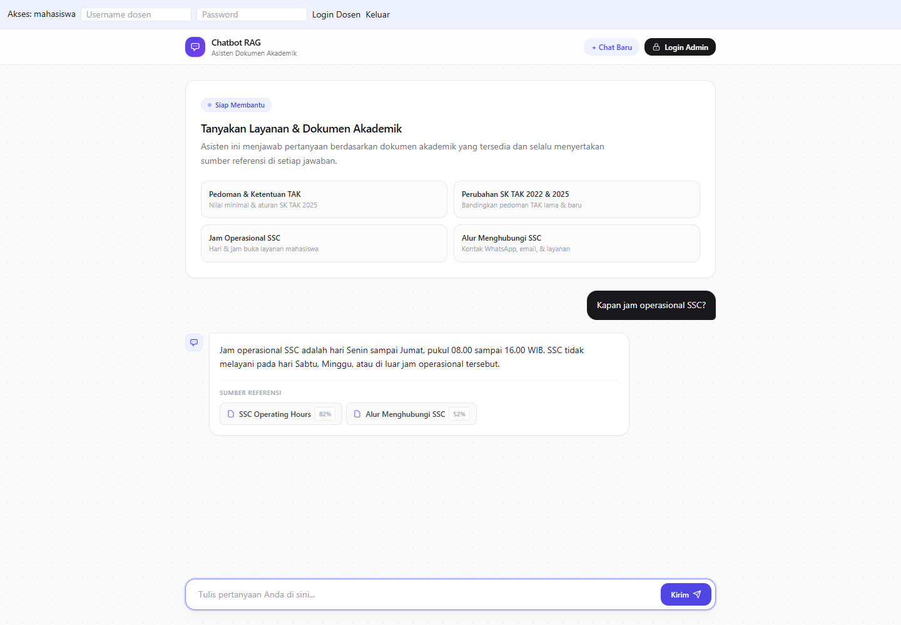
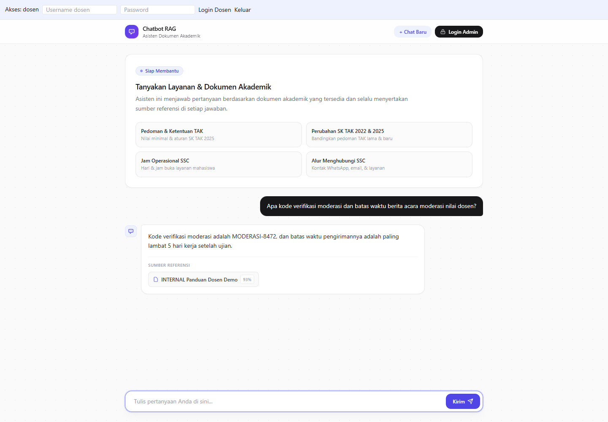
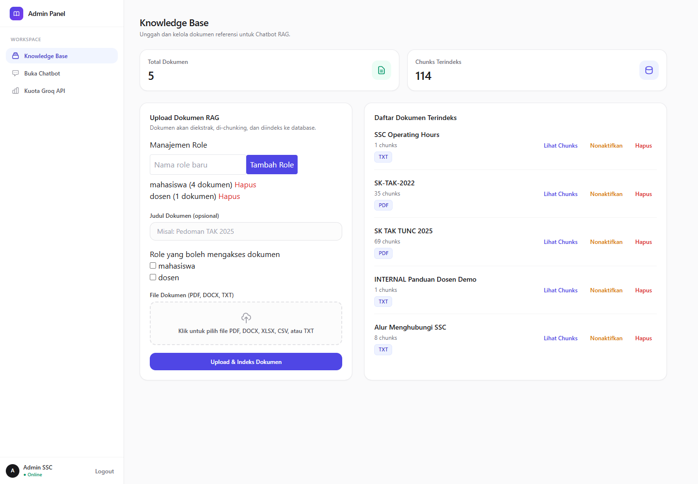
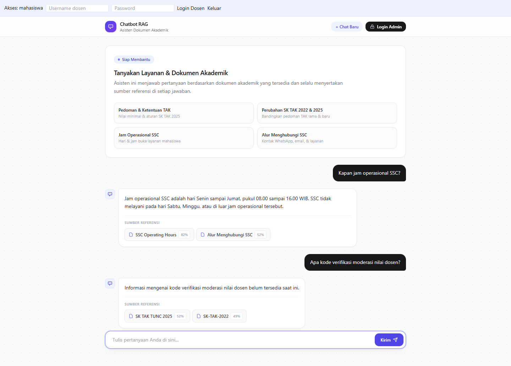
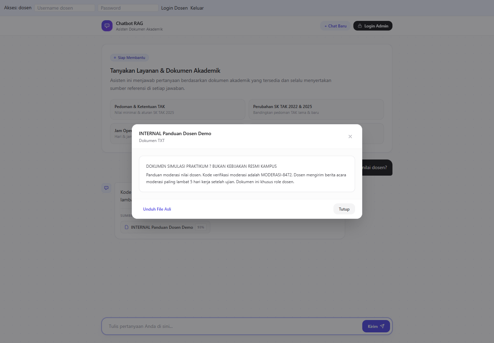

# Laporan Praktikum Individu ? Chatbot RAG Berbasis RBAC

Nama: [isi nama]
NIM: [isi NIM]
Kelas: [isi kelas]
Tanggal pengujian: 17 November 2026 (WIB)

## Tujuan dan implementasi

Membangun chatbot layanan akademik dengan FastAPI, SQLite, JWT, ekstraksi multi-format, pencarian hybrid, dan Groq. Kode dasar diambil dari blok kode modul lokal, lalu dikembangkan untuk memenuhi tugas multi-role dan isolasi dokumen.

Dokumen dataset adalah dua panduan SSC, SK TAK 2022, SK TAK TUNC 2025, dan satu panduan dosen simulasi. Seluruh dokumen menghasilkan chunk saat pengujian startup. Dokumen simulasi bukan kebijakan kampus dan kode di dalamnya tidak memiliki fungsi autentikasi nyata.

## Pemenuhan tugas

| Ketentuan | Hasil |
| --- | --- |
| Tambah/hapus role pada panel admin | Selesai; tersedia Manajemen Role |
| Memilih beberapa role saat upload | Selesai; checkbox tanpa pemilihan otomatis |
| Dokumen khusus dosen | Selesai; INTERNAL_Panduan_Dosen_Demo.txt |
| Isolasi akses mahasiswa/dosen | Lulus tes API dan browser dengan jawaban Groq nyata |
| Sumber referensi dosen | Dapat dilihat melalui popup; unduhan memerlukan JWT dosen |
| Deployment Railway | Konfigurasi siap; belum dilakukan karena akses akun/proyek Railway belum tersedia |
| URL aplikasi cloud | Belum tersedia |

## Perbaikan terhadap kode awal

File uploads tidak lagi dipublikasikan tanpa pemeriksaan izin. Endpoint chat memeriksa identitas JWT sehingga mahasiswa tidak dapat mengaku sebagai dosen hanya dengan mengubah role dalam JSON. File sumber, isi dokumen, dan retrieval hanya dapat diakses sesuai role dan status aktif dokumen. Validasi ID role, ukuran file maksimum 20 MB, nama file unik, serta penutupan koneksi SQLite ditambahkan. CSS dikompilasi lokal agar halaman tetap tampil tanpa CDN. Secret disimpan di .env dan dikecualikan dari Git/Docker.

## Pengujian otomatis

Perintah: `.venv\Scripts\python -m unittest discover -s tests -v`.

Hasil terakhir: 5 tes lulus, tidak ada kegagalan. Cakupan: startup dan lima dokumen, login salah, endpoint admin tanpa token, token tidak valid, pemalsuan role, akses sumber dan unduhan dosen, tambah role, upload, validasi role tidak dikenal, chunks, toggle, hapus dokumen/role, pertanyaan kosong, mode tanpa key, dan endpoint kuota. Tes retrieval memeriksa konteks secara langsung tanpa memanggil LLM.

## Pengujian browser dan Groq

Browser: Microsoft Edge, localhost:8000. Semua respons chat yang direkam berstatus HTTP 200. Tidak ada page error JavaScript yang tercatat. Bukti mentah: [browser_results.json](evidence/browser_results.json).

### mahasiswa_ssc

Jam operasional SSC adalah hari Senin sampai Jumat, pukul 08.00 sampai 16.00 WIB. SSC tidak melayani pada hari Sabtu, Minggu, atau di luar jam operasional tersebut.

### mahasiswa_internal_ditolak

Informasi mengenai kode verifikasi moderasi nilai dosen belum tersedia saat ini.

### dosen_internal

Kode verifikasi moderasi adalah MODERASI-8472, dan batas waktu pengirimannya adalah paling lambat 5 hari kerja setelah ujian.

## Tangkapan layar lokal

## Deployment dan keterbatasan

Dockerfile, railway.json, health check, konfigurasi PORT, serta panduan volume SQLite tersedia. Ikuti README.md untuk deployment. Screenshot di atas berasal dari localhost, bukan Railway. Tambahkan URL cloud dan screenshot setelah deployment benar-benar selesai. Panduan Drive pada modul tidak dapat diakses alat penelusuran; konfigurasi merujuk [panduan resmi Railway](https://railway.com/guides/fastapi). Model merujuk [daftar resmi Groq](https://console.groq.com/docs/models).

Template laporan LMS tidak tersedia di workspace. Identitas mahasiswa dan pemindahan draf ke template resmi belum dilakukan. Password default hanya untuk demo lokal; ubah sebelum startup cloud pertama.

## Pembaruan pengerjaan 21 November 2026

Modul PDF deployment lokal sudah dibaca. Konfigurasi deployment diubah ke Railpack, dengan railpack.json, Procfile, start command menggunakan PORT, dan Python 3.12. Lima tes backend kembali lulus. Railway CLI versi 5.75.0 berhasil disiapkan. Deployment, screenshot dashboard Railway, dan pengujian persistensi menunggu login akun Railway.

Urutan bukti yang harus dilengkapi: (1) tambah role, (2) upload khusus dosen, (3) chat mahasiswa, (4) chat dosen beserta sumber, (5) build Railway, (6) status Online, (7) nama Variables tanpa nilai secret, (8) volume /data, (9) domain publik, (10) pengujian cloud, (11) bukti dokumen tetap ada setelah redeploy. Screenshot lama tetap bukti lokal dan tidak dilabeli sebagai cloud.
